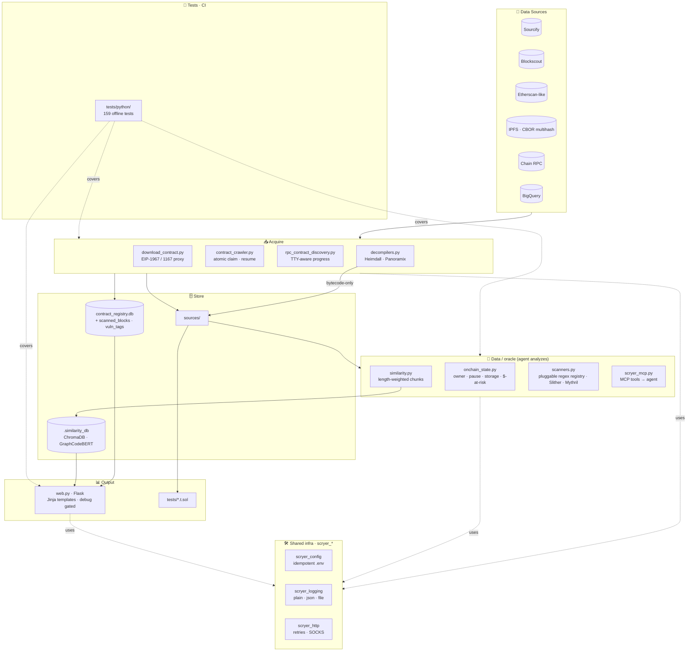

# 🔮 Scryer

**Multi-chain EVM contract security research toolkit.**

Pulls verified source from 8 EVM chains, falls back to bytecode decompilation when source is missing, reads live on-chain state (owner/pause/storage/$-at-risk), indexes everything for similarity search, and ships Foundry templates for PoC reproduction. Exposed as an MCP server so an AI agent can fetch/verify/relate contracts and do the vulnerability analysis itself.

> Originally a single-purpose BscScan downloader. Grew into a one-stop data/oracle toolkit for bounty hunters and security researchers. Analysis is left to the agent — scryer provides ground truth, not verdicts.

---

## What it does

| Stage | Module | Notes |
|-------|--------|-------|
| **Download** | [`download_contract.py`](download_contract.py) | Sourcify → Blockscout → Etherscan-like → IPFS metadata. EIP-1967 / EIP-1167 proxy resolution. |
| **Crawl** | [`contract_crawler.py`](contract_crawler.py) | Bulk verified-contract crawl across 8 chains, async + rate-limited; atomic claim-based resume so multiple workers don't double-fetch. |
| **Discover** | [`rpc_contract_discovery.py`](rpc_contract_discovery.py) | RPC block scanner. Pulls source if available, decompiles bytecode otherwise. TTY-aware progress (live `\r` on terminals, ~5% steps via logger off-tty). |
| **Decompile** | [`decompilers.py`](decompilers.py) | Heimdall-rs (via WSL on Windows) + Panoramix fallback. |
| **Index** | [`contract_registry.py`](contract_registry.py) | SQLite registry keyed by source hash → fast clone discovery across chains. Downloads via the MCP auto-register, so the corpus grows from use. |
| **State** | [`onchain_state.py`](onchain_state.py) | Live on-chain reads: owner/admin/pause/proxy impl, raw storage slots, native + token holdings priced in USD via DeFiLlama (free, no key) — the $-at-risk input to severity. |
| **Scan** | [`scanners.py`](scanners.py) | Curated regex rules (SWC-aligned) matched against whole files with comment bodies masked, so multi-line call shapes (`swap…(\n amt,\n 0,\n …)`) are caught, commented-out code stays quiet, and each finding carries `line`..`end_line`; `max_findings` bounds work as well as output; pluggable via `RegexRule.from_dict` + `load_rules_from_file` (`match_in: "all"` for comment-targeting rules); optional Slither + Mythril + `forge test`. |
| **Compare** | [`similarity.py`](similarity.py) + [`similarity_cli.py`](similarity_cli.py) | GraphCodeBERT embeddings (length-weighted chunk averaging) + ChromaDB vector store. |
| **MCP** | [`scryer_mcp.py`](scryer_mcp.py) | MCP server exposing fetch / verify / state / relate as tools for an AI agent (e.g. a `hunter` agent). Proxy-aware: returns the implementation's source, not just the shell. The agent does the analysis. |
| **Browse** | [`web.py`](web.py) + [`templates/`](templates/) | Local Flask dashboard over the registry; Jinja templates extend `base.html`; debug gated by `FLASK_DEBUG` env. |
| **Reproduce** | [`tests/`](tests/) | Foundry forks + PoC templates (e.g. MARS staking sync drain). |
| **Test** | [`tests/python/`](tests/python/) | offline pytest cases over the pipeline (cache / scanners / rule packs / similarity / web routes / whale watcher / download / verify / IPFS extraction). |

## Architecture



---

## Quick Start

### 1. Python deps

```bash
# Minimal runtime
pip install -r requirements.txt

# Or, editable install + extras (recommended for development)
pip install -e ".[dev]"           # runtime + dev tools
pip install -e ".[similarity]"    # heavy similarity stack (torch / chromadb)
pip install -e ".[bigquery]"      # BigQuery contract fetching
```

### 2. Foundry (for PoC tests)

```bash
curl -L https://foundry.paradigm.xyz | bash && foundryup
forge install foundry-rs/forge-std --no-commit
```

On Windows the test harness in this repo runs forge via WSL — see [`tests/`](tests/).

### 3. Configure secrets

```bash
cp .env.example .env
```

Minimal: one **Etherscan V2** key (`ETHERSCAN_API_KEY`) — a single key covers all chains via the V2 unified endpoint, so no per-chain explorer keys are needed. Add `ALCHEMY_KEY` (or any RPC) for on-chain state reads. **No LLM keys required** — analysis is done by the connecting agent, not by scryer. Full list in [.env.example](.env.example).

---

## Usage

### Download a single contract

```bash
# BSC mainnet (default)
python download_contract.py 0x1234...

# Resolve proxy implementation
python download_contract.py 0x1234... --follow-proxy

# Different chain + flat layout
python download_contract.py 0x1234... --chain-id 1 --layout flat
```

### Bulk crawl verified contracts

```bash
python contract_crawler.py                              # all chains, past 365d
python contract_crawler.py --chains 56,137              # BSC + Polygon only
python contract_crawler.py --days 30 --max-per-chain 1000
```

### RPC discovery (catches unverified contracts)

```bash
python rpc_contract_discovery.py --chain 56 --days 7
python rpc_contract_discovery.py --chains 56,137,42161
```

Source-less contracts get decompiled (Heimdall first, Panoramix fallback) and saved to `sources/` with a header marker.

### Analysis = the agent's job

scryer no longer ships an LLM audit pipeline. Fetch verified source (above),
then let an AI agent (e.g. a `hunter` agent over the MCP server) read it and do
the vulnerability reasoning. scryer provides ground truth — source, verification,
on-chain state, clone relationships — not verdicts.

### Regex rule packs

The default SWC-style regex set lives in [scanners.py](scanners.py); layer your
own with `load_rules_from_file`. [`rules/unprotected_withdraw.json`](rules/unprotected_withdraw.json)
ships as an example pack (public-withdraw / batch-distribute bug class).

Rule schema: `[{rule_id, severity, title, pattern, flags?, match_in?}, ...]`.
`run_regex_scan(files, rules=...)` in [scanners.py](scanners.py) consumes them
(the rule packs are also used by the whale-watcher scan summary).

### Source verification

Re-compile the downloaded source with the metadata-recorded compiler and compare
to `eth_getCode` to confirm the explorer's "verified" claim is genuine (removes
Sourcify / Etherscan / Blockscout from your trust chain). Requires a matching
`solc` on `$PATH` (or via [solc-select](https://github.com/crytic/solc-select)).

```bash
python verify_source.py --chain-id 1 --address 0xAC85eF...95f2e
```

Verdicts: `full_match` / `partial_match` (runtime identical except metadata
trailer) / `mismatch` / `indeterminate` (couldn't compile/compare — not a
mismatch) / `no_solc` / `no_bytecode`. Cached in `.verify_cache.db`. Also exposed
as the `verify_source` MCP tool.

### Similarity search

```bash
python similarity_cli.py index --sources-dir sources
python similarity_cli.py search --query contract.sol --min-similarity 0.8
python similarity_cli.py clones --query contract.sol
```

### Whale-deposit watcher

Polls major-stablecoin `Transfer` logs on configured chains, filters to
contract recipients above a USD threshold, persists hits to
`.whale_watcher.db`. Pairs with the `/whales` web route below — useful for
spotting freshly-funded launchpads / vaults that are candidates for an
automated audit pass.

```bash
python scryer_whale_watcher.py --mode once                       # single sweep
python scryer_whale_watcher.py --mode daemon --poll-interval-s 30
python scryer_whale_watcher.py --threshold-usd 100000 --chains 1,56
python scryer_whale_watcher.py --tokens-file extra_tokens.json   # add chains/tokens
```

Default tokens cover ETH (USDT/USDC/DAI) and BSC (USDT/USDC/BUSD). Per-chain
RPC URLs come from env vars (`ETH_RPC_URL`, `BSC_RPC_URL`, etc.) with
public-RPC fallbacks.

### Web UI

```bash
python web.py     # http://localhost:5000
```

Routes: `/` dashboard, `/contracts`, `/duplicates`, `/hash/<hash>`,
`/contract/<chain>/<addr>`, `/search`, `/similarity`, `/vulnerabilities`,
`/whales` (tails `whale_watcher.db`, joins against the contract registry to
flag indexed vs. unseen receivers). JSON mirrors at `/api/stats`,
`/api/contracts`, `/api/related/<chain>/<addr>`, `/api/whales`,
`/api/export/<csv|json>`. Configure with `FLASK_PORT` / `FLASK_DEBUG` env
vars (debug stays off by default — Werkzeug's debugger is RCE-prone if
exposed).

### Foundry PoC tests

```bash
forge test                                         # all
forge test --match-contract TxSimulation -vv       # MARS staking drain PoC
```

The bundled [`TxSimulation.t.sol`](tests/TxSimulation.t.sol) reproduces a real BSC exploit on a Tenderly fork — buys MARS to inflate the pool, calls `STAKING.sync()` to drain the staking contract's USDT, sells back for net profit. Replace the fork RPC URL with your own Tenderly endpoint.

---

## Project Structure

```
├── download_contract.py        # Single contract source downloader
├── contract_crawler.py         # Multi-chain bulk crawler
├── rpc_contract_discovery.py   # RPC block scanner + decompile fallback
├── contract_registry.py        # SQLite contract metadata registry
├── data_sources.py             # Blockscout / on-chain / BigQuery integrations
├── decompilers.py              # Heimdall / Panoramix bytecode decompilation
├── onchain_state.py            # live on-chain reads (owner/pause/storage/$-at-risk)
├── scryer_mcp.py               # MCP server (fetch/verify/state/relate) for an AI agent
├── similarity.py               # GraphCodeBERT embedding + ChromaDB
├── similarity_cli.py           # Similarity search CLI
├── scanners.py                 # Regex + Slither vulnerability scanner
├── report_renderer.py          # Markdown / HTML report generation
├── web.py                      # Flask web dashboard
├── cache.py                    # Generic on-disk cache helper
│
├── tests/                      # Foundry PoC tests
│   ├── TxSimulation.t.sol      # MARS staking sync drain PoC (passes)
│   ├── MpcPoc.t.sol            # PoC scaffold
│   └── exp.t.sol               # Exploit PoC templates
├── foundry.toml                # Foundry config
│
├── sources/                    # Downloaded contract sources       (gitignored)
├── decompiled/                 # Bytecode / disasm / decompiled.sol (gitignored)
├── .contract_registry.db       # SQLite registry                   (gitignored)
└── .similarity_db/             # ChromaDB vector database          (gitignored)
```

---

## Supported Chains

| Chain | ID | Explorer | Sourcify |
|-------|----|----------|----------|
| Ethereum | 1 | etherscan.io | ✓ |
| BSC | 56 | bscscan.com | ✓ |
| Polygon | 137 | polygonscan.com | ✓ |
| Arbitrum | 42161 | arbiscan.io | ✓ |
| Optimism | 10 | optimistic.etherscan.io | ✓ |
| Avalanche | 43114 | snowtrace.io | ✓ |
| Fantom | 250 | ftmscan.com | ✓ |
| Base | 8453 | basescan.org | ✓ |

---

## MCP server

[`scryer_mcp.py`](scryer_mcp.py) exposes scryer as an MCP server (stdio) so an AI
agent drives it and does the analysis itself. Tools: `health`, `download_contract`
(proxy-aware, auto-registers to the corpus), `verify_source`, `get_state`,
`read_storage`, `token_exposure`, `registry_clones`, `registry_tag_vulnerability`,
`registry_vulnerable`. No LLM keys — the connecting agent is the analyst.

```bash
claude mcp add scryer -s user -- /path/to/.venv/bin/python /path/to/scryer_mcp.py
```

Requires `mcp` pinned `<2` in the server's venv (FastMCP v1 API).

---

## Development

```bash
pip install -e ".[dev]"          # editable install with dev extras

ruff check .                     # lint (configured in pyproject.toml)
ruff format .                    # auto-format
mypy .                           # type-check (incremental, see pyproject.toml)
pytest                           # run Python unit tests
pytest --cov=. --cov-report=term # with coverage
```

Python tests live in `tests/python/` and never hit the network — anything
that needs network is gated behind `@pytest.mark.network` and excluded by
default. Foundry exploit PoCs in `tests/*.t.sol` are run with `forge test`,
not pytest.

CI (`.github/workflows/ci.yml`) runs `ruff check`, `mypy`, and `pytest` on
Python 3.11 / 3.12 / 3.13 on every push and pull request. See
[AGENTS.md](AGENTS.md) for full project conventions.

### Shared infrastructure (use in new code)

| Module | Replaces | Purpose |
|--------|----------|---------|
| `scryer_config` | direct `load_dotenv()` calls | One-shot, idempotent env loading + typed accessors (`get_int`, `get_bool`, `get_list`). |
| `scryer_logging` | bare `print()` | Structured logger via `get_logger(__name__)`; supports `plain` / `json` formats and optional file sink. |
| `scryer_http`    | `httpx.AsyncClient(...)` | Shared client factory with timeouts, retries, default `User-Agent`, and SOCKS-proxy fallback. |

All domain modules already route through these. New modules should do the same.

## ⚠️ Disclaimer

Outputs are **heuristic** (regex scans) or **probabilistic** (LLM audits). Always validate findings with:
- Human security researcher review
- Formal verification tools (Certora, Halmos, …)
- Foundry / Echidna fuzzing & invariant tests

Never deploy to production based solely on automated audit output.
