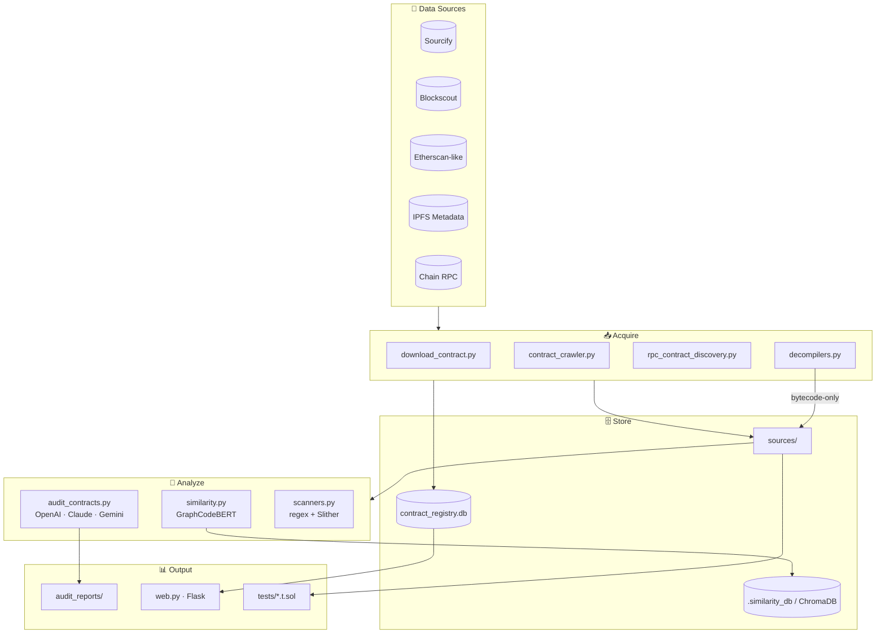

# 🔮 Scryer

**Multi-chain EVM contract security research toolkit.**

Pulls verified source from 8 EVM chains, falls back to bytecode decompilation when source is missing, runs LLM-powered audits with map-reduce chunking, indexes everything for similarity search, and ships Foundry templates for PoC reproduction.

> Originally a single-purpose BscScan downloader. Grew into a one-stop pipeline for bounty hunters and security researchers.

---

## What it does

| Stage | Module | Notes |
|-------|--------|-------|
| **Download** | [`download_contract.py`](download_contract.py) | Sourcify → Blockscout → Etherscan-like → IPFS metadata. EIP-1967 / EIP-1167 proxy resolution. |
| **Crawl** | [`contract_crawler.py`](contract_crawler.py) | Bulk verified-contract crawl across 8 chains, async + rate-limited. |
| **Discover** | [`rpc_contract_discovery.py`](rpc_contract_discovery.py) | RPC block scanner. Pulls source if available, decompiles bytecode otherwise. |
| **Decompile** | [`decompilers.py`](decompilers.py) | Heimdall-rs (via WSL on Windows) + Panoramix fallback. |
| **Index** | [`contract_registry.py`](contract_registry.py) | SQLite registry keyed by source hash → fast clone discovery across chains. |
| **Audit** | [`audit_contracts.py`](audit_contracts.py) + [`llm_providers.py`](llm_providers.py) | OpenAI / Claude / Gemini, JSON-mode prompts, map-reduce for huge codebases. |
| **Scan** | [`scanners.py`](scanners.py) | Curated regex rules (SWC-aligned) + optional Slither. |
| **Compare** | [`similarity.py`](similarity.py) + [`similarity_cli.py`](similarity_cli.py) | GraphCodeBERT embeddings + ChromaDB vector store. |
| **Pipeline** | [`bounty_pipeline.py`](bounty_pipeline.py) | One-shot download + audit driven by a target JSON. |
| **Browse** | [`web.py`](web.py) | Local Flask dashboard over the registry. |
| **Reproduce** | [`tests/`](tests/) | Foundry forks + PoC templates (e.g. MARS staking sync drain). |

## Architecture



---

## Quick Start

### 1. Python deps

```bash
# Minimal runtime
pip install -r requirements.txt

# Or, editable install + extras (recommended for development)
pip install -e ".[dev]"           # runtime + dev tools
pip install -e ".[similarity]"    # heavy similarity stack (torch / chromadb)
pip install -e ".[bigquery]"      # BigQuery contract fetching
```

### 2. Foundry (for PoC tests)

```bash
curl -L https://foundry.paradigm.xyz | bash && foundryup
forge install foundry-rs/forge-std --no-commit
```

On Windows the test harness in this repo runs forge via WSL — see [`tests/`](tests/).

### 3. Configure secrets

```bash
cp .env.example .env
```

Minimal: `OPENAI_API_KEY` for audits, plus at least one explorer API key (`BSCSCAN_API_KEY`, `ETHERSCAN_API_KEY`, …) for the chains you target. Full key list lives in [.env.example](.env.example).

---

## Usage

### Download a single contract

```bash
# BSC mainnet (default)
python download_contract.py 0x1234...

# Resolve proxy implementation
python download_contract.py 0x1234... --follow-proxy

# Different chain + flat layout
python download_contract.py 0x1234... --chain-id 1 --layout flat
```

### Bulk crawl verified contracts

```bash
python contract_crawler.py                              # all chains, past 365d
python contract_crawler.py --chains 56,137              # BSC + Polygon only
python contract_crawler.py --days 30 --max-per-chain 1000
```

### RPC discovery (catches unverified contracts)

```bash
python rpc_contract_discovery.py --chain 56 --days 7
python rpc_contract_discovery.py --chains 56,137,42161
```

Source-less contracts get decompiled (Heimdall first, Panoramix fallback) and saved to `sources/` with a header marker.

### Bounty pipeline (download + audit a target list)

```bash
python bounty_pipeline.py --targets targets.json
python bounty_pipeline.py --targets targets.json --download-only
python bounty_pipeline.py --targets targets.json --slither --model gpt-4.1
```

Target schema in [targets.example.json](targets.example.json).

### LLM audit

```bash
python audit_contracts.py                       # default OpenAI
python audit_contracts.py --provider claude     # Sonnet 4.6 default
python audit_contracts.py --provider gemini     # 2.5-flash default
python audit_contracts.py --max-chunk-chars 50000   # force map-reduce
python audit_contracts.py --html                # Markdown + HTML output
```

### Similarity search

```bash
python similarity_cli.py index --sources-dir sources
python similarity_cli.py search --query contract.sol --min-similarity 0.8
python similarity_cli.py clones --query contract.sol
```

### Web UI

```bash
python web.py     # http://localhost:5000
```

### Foundry PoC tests

```bash
forge test                                         # all
forge test --match-contract TxSimulation -vv       # MARS staking drain PoC
```

The bundled [`TxSimulation.t.sol`](tests/TxSimulation.t.sol) reproduces a real BSC exploit on a Tenderly fork — buys MARS to inflate the pool, calls `STAKING.sync()` to drain the staking contract's USDT, sells back for net profit. Replace the fork RPC URL with your own Tenderly endpoint.

---

## Project Structure

```
├── download_contract.py        # Single contract source downloader
├── contract_crawler.py         # Multi-chain bulk crawler
├── rpc_contract_discovery.py   # RPC block scanner + decompile fallback
├── contract_registry.py        # SQLite contract metadata registry
├── data_sources.py             # Blockscout / on-chain / BigQuery integrations
├── decompilers.py              # Heimdall / Panoramix bytecode decompilation
├── bounty_pipeline.py          # download + audit a JSON target list
├── audit_contracts.py          # AI-powered audit pipeline (map-reduce)
├── llm_providers.py            # OpenAI / Claude / Gemini abstraction
├── similarity.py               # GraphCodeBERT embedding + ChromaDB
├── similarity_cli.py           # Similarity search CLI
├── scanners.py                 # Regex + Slither vulnerability scanner
├── report_renderer.py          # Markdown / HTML report generation
├── web.py                      # Flask web dashboard
├── cache.py                    # Generic on-disk cache helper
│
├── tests/                      # Foundry PoC tests
│   ├── TxSimulation.t.sol      # MARS staking sync drain PoC (passes)
│   ├── MpcPoc.t.sol            # PoC scaffold
│   └── exp.t.sol               # Exploit PoC templates
├── prompts/                    # LLM prompt templates (audit / map / reduce)
├── foundry.toml                # Foundry config
│
├── sources/                    # Downloaded contract sources       (gitignored)
├── audit_reports/              # Generated audit reports           (gitignored)
├── runs/                       # bounty_pipeline.py run dirs       (gitignored)
├── decompiled/                 # Bytecode / disasm / decompiled.sol (gitignored)
├── .contract_registry.db       # SQLite registry                   (gitignored)
└── .similarity_db/             # ChromaDB vector database          (gitignored)
```

---

## Supported Chains

| Chain | ID | Explorer | Sourcify |
|-------|----|----------|----------|
| Ethereum | 1 | etherscan.io | ✓ |
| BSC | 56 | bscscan.com | ✓ |
| Polygon | 137 | polygonscan.com | ✓ |
| Arbitrum | 42161 | arbiscan.io | ✓ |
| Optimism | 10 | optimistic.etherscan.io | ✓ |
| Avalanche | 43114 | snowtrace.io | ✓ |
| Fantom | 250 | ftmscan.com | ✓ |
| Base | 8453 | basescan.org | ✓ |

---

## LLM Providers

Switchable via `--provider` flag on [audit_contracts.py](audit_contracts.py); defaults set in [llm_providers.py](llm_providers.py):

| Provider | Default model | Env key |
|----------|---------------|---------|
| OpenAI | `gpt-4.1-mini` | `OPENAI_API_KEY` |
| Anthropic | `claude-sonnet-4-6` | `ANTHROPIC_API_KEY` |
| Google | `gemini-2.5-flash` | `GOOGLE_API_KEY` / `GEMINI_API_KEY` |

For codebases > 200K chars the audit pipeline auto-switches to map-reduce: each file is summarized via `prompts/solidity_map_prompt.txt` then merged via `solidity_reduce_prompt.txt`.

---

## Development

```bash
pip install -e ".[dev]"          # editable install with dev extras

ruff check .                     # lint (configured in pyproject.toml)
ruff format .                    # auto-format
mypy .                           # type-check (incremental, see pyproject.toml)
pytest                           # run Python unit tests
pytest --cov=. --cov-report=term # with coverage
```

Python tests live in `tests/python/` and never hit the network — anything
that needs network is gated behind `@pytest.mark.network` and excluded by
default. Foundry exploit PoCs in `tests/*.t.sol` are run with `forge test`,
not pytest.

CI (`.github/workflows/ci.yml`) runs `ruff check`, `mypy`, and `pytest` on
Python 3.11 / 3.12 / 3.13 on every push and pull request. See
[AGENTS.md](AGENTS.md) for full project conventions.

### Shared infrastructure (use in new code)

| Module | Replaces | Purpose |
|--------|----------|---------|
| `scryer_config` | direct `load_dotenv()` calls | One-shot, idempotent env loading + typed accessors (`get_int`, `get_bool`, `get_list`). |
| `scryer_logging` | bare `print()` | Structured logger via `get_logger(__name__)`; supports `plain` / `json` formats and optional file sink. |
| `scryer_http`    | `httpx.AsyncClient(...)` | Shared client factory with timeouts, retries, default `User-Agent`, and SOCKS-proxy fallback. |

Existing modules will be migrated incrementally — keep changes scoped per PR.

## ⚠️ Disclaimer

Outputs are **heuristic** (regex scans) or **probabilistic** (LLM audits). Always validate findings with:
- Human security researcher review
- Formal verification tools (Certora, Halmos, …)
- Foundry / Echidna fuzzing & invariant tests

Never deploy to production based solely on automated audit output.
